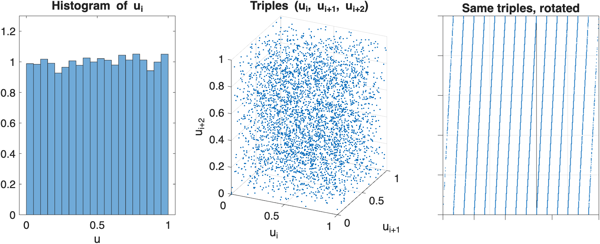
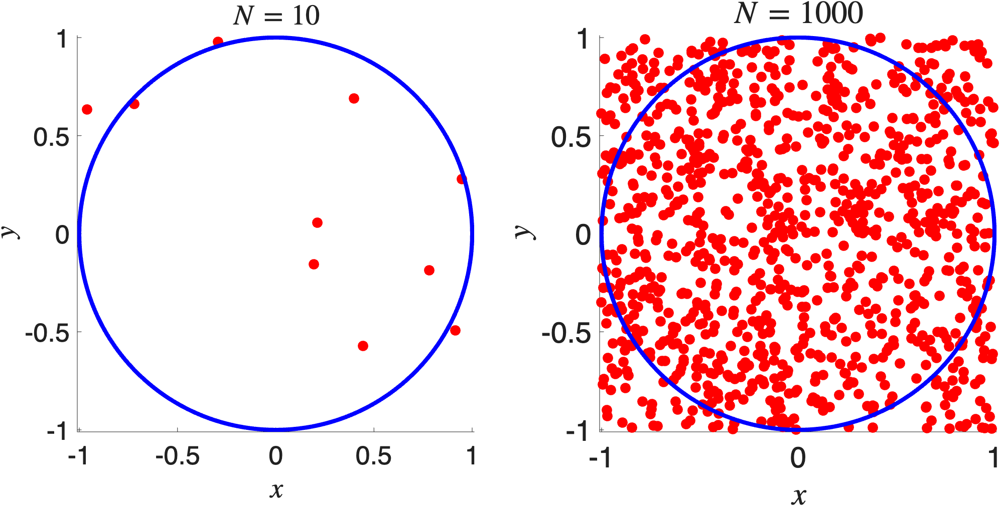
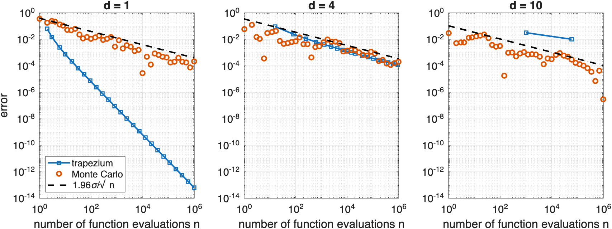
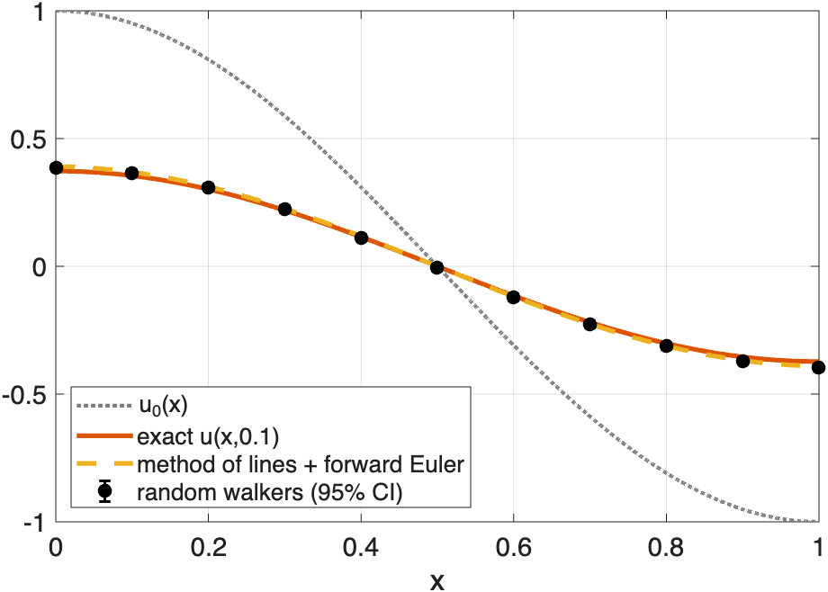

## Two further topics

- **Partial differential equations:** the method of lines turns a PDE into a large system of ODEs
- **Monte Carlo methods:** random numbers, error bars, the curse of dimensionality, variance reduction

The two meet at the end: random walkers solve the heat equation.

# Partial Differential Equations

## How can we solve PDEs numerically?

- Many PDEs can be reduced to large systems of ODEs: the **method of lines**
- Then use any timestepping method from Chapter 5
- We illustrate with the simplest example: the 1D heat equation
- A vast field: computational fluid dynamics, numerical relativity, finite elements, ... (and [VisualPDE.com](https://VisualPDE.com))

## The heat equation

$$
\frac{\partial u}{\partial t} = \alpha \frac{\partial^2 u}{\partial x^2}, \quad x \in [0,L], \quad t > 0, \qquad \alpha > 0
$$

- **Initial condition:** $u(x,0) = u_0(x)$
- Homogeneous **Neumann boundary conditions:**
$$
\frac{\partial u}{\partial x}(0,t) = \frac{\partial u}{\partial x}(L,t) = 0
$$
- Physically: an insulated rod, with no heat flowing in or out

## Spatial discretisation

Uniform grid of $N$ nodes:
$$
x_j = (j-1) \Delta x, \quad j = 1, \dots, N, \quad \Delta x = \frac{L}{N-1}, \qquad u_j(t) \approx u(x_j, t)
$$

so $x_1 = 0$ and $x_N = L$. Centred difference (Chapter 4):
$$
\frac{\partial^2 u}{\partial x^2}(x_j,t) \approx \frac{u_{j-1}(t) - 2u_j(t) + u_{j+1}(t)}{(\Delta x)^2}
$$

## Ghost nodes

- At $j = 1$ and $j = N$ the stencil needs $u_0$ and $u_{N+1}$
- Introduce **ghost nodes** $x_0 = -\Delta x$ and $x_{N+1} = L + \Delta x$ outside the domain
- Fix their values with the boundary conditions:
$$
\frac{u_1 - u_0}{\Delta x} = 0 \;\implies\; u_0 = u_1, \qquad
\frac{u_{N+1} - u_{N}}{\Delta x} = 0 \;\implies\; u_{N+1} = u_{N}
$$

## The method of lines

$$
\frac{d u_j}{dt} = \alpha\frac{u_{j-1} - 2u_j + u_{j+1}}{(\Delta x)^2}, \quad j = 1,\dots, N, \qquad u_0=u_1, \;\; u_{N+1} = u_N
$$

::: {.fragment}
For $\mathbf{u}(t) = (u_1(t), \dots, u_N(t))^\top$: $\;\dfrac{d\mathbf{u}}{dt} = \alpha \mathbf{A} \mathbf{u}$, with the $N\times N$ matrix
$$
\mathbf{A} = \frac{1}{(\Delta x)^2}
\begin{pmatrix}
 -1 & 1 & & & \\
 1 & -2 & 1 & & \\
 & \ddots & \ddots & \ddots & \\
 & & 1 & -2 & 1\\
 & & & 1 & -1
\end{pmatrix}
$$
the discrete Laplacian with Neumann boundary conditions.
:::

## Forward Euler

$$
\mathbf{u}_{n+1} = \mathbf{u}_n + \Delta t \, \alpha \mathbf{A} \mathbf{u}_n
$$

- Simple and explicit, but stability requires
$$
\Delta t \leq \frac{(\Delta x)^2}{2\alpha}
$$
- Violating this gives rapidly growing, unphysical oscillations

::: {.fragment}
Why? The eigenvalues of $\alpha\mathbf{A}$ lie in $\big[-4\alpha/(\Delta x)^2,\, 0\big]$, and forward Euler applied to $\dot u = \lambda u$ needs $-2 \le \Delta t\lambda \le 0$ (Chapter 5).

Halving $\Delta x$ forces $\Delta t$ to shrink by a factor of $4$!
:::

## Backward Euler

$$
\mathbf{u}_{n+1} = \mathbf{u}_n + \Delta t \, \alpha \mathbf{A} \mathbf{u}_{n+1}
\quad\iff\quad
(\mathbf{I} - \Delta t \,\alpha \mathbf{A})\,\mathbf{u}_{n+1} = \mathbf{u}_n
$$

- Implicit: a (tridiagonal) linear system at each step (Chapter 3)
- A-stable, so **unconditionally stable** for the heat equation
- Any $\Delta t$ is stable, but accuracy may still require small $\Delta t$

## Reaction–diffusion systems

Several species diffuse and react:
$$
\frac{\partial u}{\partial t} = D_u\frac{\partial^2 u}{\partial x^2} + f(u,v), \qquad \frac{\partial v}{\partial t} = D_v\frac{\partial^2 v}{\partial x^2} + g(u,v)
$$

- Method of lines: $\;\mathbf{u}' = D_u\mathbf{A}\mathbf{u} + f(\mathbf{u},\mathbf{v}), \quad \mathbf{v}' = D_v\mathbf{A}\mathbf{v} + g(\mathbf{u},\mathbf{v})$

::: {.fragment}
- Eigenvalues of $\mathbf{A}$ up to $4/(\Delta x)^2$ in magnitude: explicit methods need $\Delta t = O\big((\Delta x)^2\big)$, even when the solution changes slowly
- **Stiff** (Chapter 5): use implicit, adaptive stiff solvers such as `ode15s`
- Rich behaviour: spatial patterns, travelling waves, spatiotemporal chaos ([VisualPDE.com](https://VisualPDE.com))
:::

## Summary: method of lines

- Discretise in space only: PDE $\to$ large ODE system
- Integrate in time with any method from Chapter 5
- Stability and accuracy depend on **both** the spatial discretisation and the time integrator
- Code demos on Blackboard: the heat equation (matrix and for-loop versions) and the Schnakenberg reaction-diffusion system

# Monte Carlo Methods

## How can random numbers compute things that are not random?

- Many quantities are **averages**: expected payoffs, mean energies, failure probabilities
- Each is an integral, often in **very high dimension**
- **Monte Carlo:** average the integrand at random points
- Ulam, von Neumann and Metropolis, Los Alamos, 1940s

::: {.fragment}
Plan:

1. How do computers produce random numbers?
2. How do we get an estimate with an error bar?
3. Why is this crude method the method of choice in high dimensions?
:::

## Pseudorandom numbers

Computers are deterministic, so they produce **pseudorandom** numbers:
$$
s_{i+1} = g(s_i), \qquad u_i = h(s_i) \in (0,1)
$$

- $s_i$: internal **state**; $s_0$: the **seed**
- Finitely many states $\implies$ the sequence eventually repeats: the **period**
- Determinism is a feature: same seed $\implies$ same numbers (`rng(1)` in Chapter 4)

## What should we ask for?

- Each $u_i$ uniformly distributed on $[0,1]$: the *easy* part
    - $0.01, 0.02, \ldots, 0.99$ has a perfect histogram, but is not random at all!
- **Independence:** $u_1, \ldots, u_{i-1}$ tell us nothing about $u_i$
    - pairs $(u_i, u_{i+1})$ fill the unit square uniformly
    - triples $(u_i, u_{i+1}, u_{i+2})$ fill the unit cube uniformly, ...

## Linear congruential generators

::: {.defn}
[Linear congruential generator (LCG)]{.box-title}
$$
x_{i+1} = (a x_i + c) \bmod m, \qquad u_{i+1} = \frac{x_{i+1}}{m},
$$
with integers $a$ (multiplier), $c$ (increment) and $m$ (modulus).
:::

::: {.fragment}
::: {.eg}
[$a=6$, $c=0$, $m=11$, seed $x_0 = 1$]{.box-title}
$$
1, 6, 3, 7, 9, 10, 5, 8, 4, 2, 1, 6, \ldots \qquad \text{(period 10)}
$$
With $a=3$: $\; 1, 3, 9, 5, 4, 1, \ldots \;$ (period only $5$).
:::
:::

- Period at most $m$; number theory says how to achieve it. But a long period is not enough...

## RANDU

$a = 65539 = 2^{16}+3$, $\; c=0$, $\; m=2^{31}$: supplied with IBM mainframes in the 1960s

{fig-align="center" height="400"}

All triples $(u_i, u_{i+1}, u_{i+2})$ lie on just $15$ planes!

## Why 15 planes?

$$
a^2 = 2^{32} + 6\cdot 2^{16} + 9 = 2^{32} + 6a - 9
$$

::: {.fragment}
Since $2^{32}$ is a multiple of $2^{31}$:
$$
x_{i+2} = a^2 x_i \bmod 2^{31} = (6 a x_i - 9 x_i) \bmod 2^{31} = (6x_{i+1} - 9x_i) \bmod 2^{31}
$$
:::

::: {.fragment}
So $9x_i - 6x_{i+1} + x_{i+2}$ is a multiple of $2^{31}$:
$$
9u_i - 6u_{i+1} + u_{i+2} = k \in \mathbb{Z}
$$
:::

::: {.fragment}
LHS $\in(-6, 10)$, so $k \in \{-5, \ldots, 9\}$: **15 planes**.
:::

## MATLAB demo: RANDU

```matlab
n = 3e4;
x = zeros(n, 1);  x(1) = 1;              % seed
for i = 1:n-1
    x(i+1) = mod(65539*x(i), 2^31);      % exact: 65539*x(i) < 2^53 (Chapter 1)
end
u = x/2^31;
plot3(u(1:end-2), u(2:end-1), u(3:end), '.', 'MarkerSize', 2)
view([2 3 0])                            % look along the planes
```

- Every LCG has this defect (Marsaglia, 1968): $d$-tuples lie on at most $(d!\,m)^{1/d}$ hyperplanes

## Modern generators

- MATLAB default: **Mersenne Twister**, period $2^{19937}-1$, equidistributed in up to $623$ dimensions
- PCG (NumPy), xoshiro (Julia)
- GPUs: **counter-based** generators such as Philox, $u_i = h(\text{key}, i)$, so each core jumps straight to its own part of the sequence

::: {.fragment}
Practical lessons:

- Never write your own generator
- Always record your seed
- Parallel computations need independent streams
:::

# Testing Generators

## Hypothesis testing

> $H_0$: $u_1, \ldots, u_n$ are independent samples from the uniform distribution on $[0,1]$

- A test can never show that $H_0$ is true (the numbers are not random!)
- Failing a test reveals a detectable non-random pattern

::: {.defn}
[Chi-squared distribution]{.box-title}
If $Z_1, \ldots, Z_\nu$ are independent standard normal random variables, then $Z_1^2 + \cdots + Z_\nu^2$ has the **chi-squared distribution** with $\nu$ degrees of freedom, $\chi^2_\nu$.
:::

## The chi-squared test statistic

- Partition $[0,1]$ into $k$ equal bins $[0,\tfrac1k), \ldots, [\tfrac{k-1}{k},1]$
- $n_j$ = number of samples in bin $j$; expected count $n/k$ under $H_0$

$$
T = \sum_{j=1}^k \frac{(n_j - n/k)^2}{n/k} = \frac{k}{n}\sum_{j=1}^k \left(n_j - \frac{n}{k}\right)^2
$$

::: {.thm}
Under $H_0$, $T$ converges in distribution to $\chi^2_{k-1}$ as $n\to\infty$.
:::

::: {.fragment}
Intuition: $n_j \approx$ normal with mean and variance $\approx n/k$, so each term $\approx Z^2$. The constraint $n_1 + \cdots + n_k = n$ removes one degree of freedom.
:::

## Carrying out the test

- Choose a **significance level** $\alpha$, typically $0.05$
- Critical value $c$: the $(1-\alpha)$-quantile of $\chi^2_{k-1}$, `chi2inv(1 - alpha, k - 1)`
- $T > c$: reject $H_0$, the sample **fails**; otherwise it **passes**
- If $H_0$ is true, the sample wrongly fails with probability $\approx \alpha$
- Need expected counts $n/k \gtrsim 5$

## Example: ten bins

::: {.eg}
[$n = 1000$ numbers, $k = 10$ bins, expected count $100$]{.box-title}

| Bin $j$ | 1 | 2 | 3 | 4 | 5 | 6 | 7 | 8 | 9 | 10 |
|:--|:--|:--|:--|:--|:--|:--|:--|:--|:--|:--|
| $n_j$ | 98 | 104 | 112 | 107 | 94 | 95 | 108 | 97 | 96 | 89 |

::: {.fragment}
$$
T = \frac{10}{1000}\left[(-2)^2 + 4^2 + 12^2 + 7^2 + (-6)^2 + (-5)^2 + 8^2 + (-3)^2 + (-4)^2 + (-11)^2\right] = 4.84
$$
:::

::: {.fragment}
`chi2inv(0.95, 9)` $\approx 16.92$, and $4.84 < 16.92$: the sample **passes**.
:::
:::

## Catching RANDU

::: {.eg}
[$n = 3\times 10^5$ numbers from RANDU, seed $x_0 = 1$]{.box-title}
**Single values**, $k = 10$ bins: $T \approx 4.3 < 16.92$. RANDU **passes**.

::: {.fragment}
**Triples** $(u_1,u_2,u_3), (u_4,u_5,u_6), \ldots$ in $k^3 = 1000$ cubes of side $0.1$:

- expected count $100$ per cube, $T \approx \chi^2_{999}$, critical value $\approx 1074$
- RANDU: counts from $68$ to $145$, $T \approx 1593$. RANDU **fails** decisively
- Mersenne Twister: $T \approx 1043$, **passes**
:::
:::

::: {.fragment}
Tests must probe **independence**, not just the histogram. Test suites (e.g. TestU01) apply hundreds of tests.
:::

# Sampling from Other Distributions

## The inverse transform method

CDF $F(x) = \mathbb{P}[X\le x]$; PDF $f = F'$.

::: {.thm}
[Inverse transform method]{.box-title}
Let $U$ be uniform on $[0,1]$ and $F$ a continuous, strictly increasing CDF. Then $X = F^{-1}(U)$ has CDF $F$.
:::

::: {.fragment}
**Proof.** $F$ is increasing, so $F^{-1}(U)\le x \iff U \le F(x)$. Hence
$$
\mathbb{P}[X \le x] = \mathbb{P}[U \le F(x)] = F(x). \quad\blacksquare
$$
:::

## Examples

::: {.eg}
[Exponential distribution]{.box-title}
$F(x) = 1 - e^{-\lambda x}$ for $x \ge 0$, so $F^{-1}(u) = -\log(1-u)/\lambda$.

$1-U$ is also uniform, so: `X = -log(rand(n, 1))/lambda`
:::

- **Exercise:** Pareto distribution, $f(x) = \alpha x_m^\alpha/x^{\alpha+1}$ for $x\ge x_m$: show $x_m (1-U)^{-1/\alpha}$ works
- No closed-form $F^{-1}$? E.g. **Box–Muller:** $\sqrt{-2\log U_1}\cos(2\pi U_2)$ and $\sqrt{-2\log U_1}\sin(2\pi U_2)$ are independent $\mathcal{N}(0,1)$
- In practice: built-in functions such as `randn`

# The Monte Carlo Estimator

## Estimating $\pi$

Points uniform on $[-1,1]^2$ land in the unit disc with probability $\pi/4$:

{fig-align="center" height="330"}

$$
\pi = \int_{-1}^1 \int_{-1}^1 \mathbb{1}\{x^2+y^2\le 1\}\,dy\,dx \approx 4\times(\text{fraction of points in the disc})
$$

## Integrals as expectations

$$
\mu = \mathbb{E}[A(X)] = \int_{\mathbb{R}^d} A(x) f(x)\,dx, \qquad X \text{ with PDF } f
$$

- $U$ uniform on $[0,1]^d$ ($f\equiv 1$):
$$
\int_{[0,1]^d} g(x)\,dx = \mathbb{E}[g(U)]
$$
- $U$ uniform on $[a,b]$ ($f \equiv 1/(b-a)$):
$$
\frac{1}{b-a}\int_a^b g(x)\,dx = \mathbb{E}[g(U)], \qquad U = a + (b-a)\,\texttt{rand}
$$

## The Monte Carlo estimator

::: {.defn}
For independent $X_1, \ldots, X_n$ distributed like $X$, the **Monte Carlo estimator** of $\mu = \mathbb{E}[A(X)]$ is
$$
\hat{\mu}_n = \frac{1}{n}\sum_{i=1}^n A(X_i).
$$
:::

## Properties of the Monte Carlo estimator

::: {.thm}
[Properties of the Monte Carlo estimator]{.box-title}
Suppose $\mathbb{E}|A(X)| < \infty$. Then:

1. **Unbiased:** $\mathbb{E}[\hat{\mu}_n] = \mu$
2. **Consistent:** $\hat{\mu}_n \to \mu$ almost surely (strong law of large numbers)
3. If $\sigma^2 = \text{Var}[A(X)] < \infty$: $\text{Var}[\hat\mu_n] = \sigma^2/n$ and (CLT)
$$
\frac{\sqrt{n}}{\sigma}(\hat{\mu}_n-\mu) \to \mathcal{N}(0,1) \quad \text{in distribution}
$$
:::

## Error bars

$z_{1-\alpha/2}$: the $(1-\alpha/2)$-quantile of $\mathcal{N}(0,1)$, so $\mathbb{P}[|Z| \le z_{1-\alpha/2}] = 1-\alpha$:
$$
\mathbb{P}\left[ |\hat\mu_n - \mu| \le z_{1-\alpha/2}\frac{\sigma}{\sqrt{n}} \right] \approx 1-\alpha
$$

- $z_{0.975} \approx 1.96$ ($95\%$), $\; z_{0.995} \approx 2.576$ ($99\%$), `norminv(1 - alpha/2)`

::: {.fragment}
Replace $\sigma$ by the sample standard deviation $\hat\sigma_n$ (`std`):

- **Standard error** $\hat\sigma_n/\sqrt{n}$: estimates the standard deviation of $\hat\mu_n$
- Approximate $100(1-\alpha)\%$ **confidence interval:** $\;\hat\mu_n \pm z_{1-\alpha/2}\,\hat\sigma_n/\sqrt{n}$
- Monte Carlo estimates its own error, for free
:::

## Example: a one-dimensional integral

::: {.eg}
[$\mu = \mathbb{E}[U^2] = \int_0^1 x^2\,dx = \tfrac13$]{.box-title}
$\sigma^2 = \mathbb{E}[U^4] - \mu^2 = \tfrac15 - \tfrac19 = \tfrac{4}{45}$: the $95\%$ half-width is $\approx 0.58/\sqrt{n}$.

```matlab
n = 1e4;
gU = rand(n, 1).^2;                      % samples of A(U) = U^2
muHat = mean(gU);
SE = std(gU)/sqrt(n);                    % standard error
fprintf('%.4f +/- %.4f\n', muHat, 1.96*SE)
```
:::

::: {.fragment}
- Error $\sim n^{-1/2}$: one more digit costs $100\times$ more samples
- $n = 10^4$: error $\approx 6\times 10^{-3}$; composite trapezium with $10^4$ points: $\approx 2\times10^{-9}$
- In one dimension, Monte Carlo is **terrible**!
:::

# The Curse of Dimensionality

## Grids in $d$ dimensions

$$
I = \int_{[0,1]^d} g(x)\,dx
$$

- **Tensor-product** rule: $m$ points per direction, $n = m^d$ points, error $O(m^{-2})$ for trapezium

::: {.fragment}
| Method | Error with $n$ evaluations |
|:--|:--|
| Trapezium | $O(n^{-2/d})$ |
| Simpson | $O(n^{-4/d})$ |
| Monte Carlo | $O(n^{-1/2})$, **independent of $d$** |
:::

::: {.fragment}
- Monte Carlo wins for $d > 4$ (trapezium) and $d > 8$ (Simpson)
- Even $2$ points per direction: $2^{100} \approx 10^{30}$ evaluations for $d = 100$
:::

## Example: $g(x) = e^{-|x|^2}$ on $[0,1]^d$

Exact: $I_d = \big(\int_0^1 e^{-s^2}\,ds\big)^d = \big(\tfrac{\sqrt\pi}{2}\,\text{erf}(1)\big)^d$

```matlab
d = 10;  n = 1e6;
gX = exp(-sum(rand(n, d).^2, 2));        % g at n uniform points in [0,1]^d
muHat = mean(gX);  SE = std(gX)/sqrt(n);
Iexact = (sqrt(pi)/2*erf(1))^d;
fprintf('%.6f +/- %.6f (exact %.6f)\n', muHat, 1.96*SE, Iexact)
```

The same few lines work in any dimension.

## Monte Carlo vs trapezium

{fig-align="center" height="330"}

- $d=1$: trapezium wins by many orders of magnitude
- $d=4$: comparable
- $d=10$: trapezium with $3^{10} = 59049$ points has error $10^{-2}$; $10^6$ Monte Carlo samples give $\sim 10^{-4}$, with an error bar

## Summary

**Monte Carlo is a poor method in one dimension and often the only practical method in a hundred.**

High-dimensional integrals are everywhere:

- **Statistical physics:** averages over configurations of $N$ spins (Ising model), via Markov chain Monte Carlo
- **Finance:** options on baskets of many assets
- **Bayesian statistics:** posterior means over all parameters
- **Computer graphics:** path tracing in animated films; grainy renders show the $n^{-1/2}$ error

# Variance Reduction

## Rare events

The rate $n^{-1/2}$ is fixed, but the constant $\sigma$ is not.

::: {.eg}
[$p = \mathbb{P}[Z > 4] \approx 3.17\times 10^{-5}$, $\; Z\sim\mathcal{N}(0,1)$]{.box-title}
Plain Monte Carlo averages $A(Z) = \mathbb{1}\{Z > 4\}$, with $\sigma^2 = p(1-p)$. Relative error:
$$
\frac{\sigma}{p\sqrt{n}} \approx \frac{1}{\sqrt{pn}}
$$

::: {.fragment}
- $n = 10^4$: we expect *fewer than one* sample above $4$
- $10\%$ relative accuracy needs $n \approx 100/p \approx 3\times 10^6$
- Almost every sample lands where $A = 0$ and is wasted
:::
:::

## Importance sampling

Sample from a different density $g$ that puts more samples where they matter, then correct with a **weight**:

$$
\mu = \int A(x) f(x)\,dx = \int A(x)\frac{f(x)}{g(x)}\, g(x)\,dx = \mathbb{E}\big[A(Y)\,w(Y)\big], \qquad Y\sim g
$$

- $w = f/g$: the **likelihood ratio**
- Need $g(x) > 0$ wherever $A(x)f(x) \neq 0$

## Importance sampling theorem

::: {.thm}
[Importance sampling]{.box-title}
For independent $Y_1, \ldots, Y_n$ with density $g$,
$$
\hat\mu_n^{\rm IS} = \frac{1}{n}\sum_{i=1}^n A(Y_i)\,w(Y_i)
$$
is unbiased for $\mu$, with variance $\sigma_g^2/n$, where
$$
\sigma_g^2 = \int \frac{A(x)^2 f(x)^2}{g(x)}\,dx - \mu^2.
$$
If $A \ge 0$ and $\mu > 0$, then $g^* = Af/\mu$ gives $\sigma_{g^*}^2 = 0$.
:::

## Importance sampling: proof

Unbiased: by the identity on the previous slide.

::: {.fragment}
Variance:
$$
\text{Var}[A(Y)w(Y)] = \mathbb{E}\big[A^2w^2\big] - \mu^2 = \int A^2\frac{f^2}{g^2}\,g\,dx - \mu^2 = \int \frac{A^2f^2}{g}\,dx - \mu^2
$$
and averaging $n$ independent copies divides by $n$.
:::

::: {.fragment}
Optimal $g^*$: wherever $A > 0$, $\; A^2f^2/g^* = \mu A f$, so
$$
\sigma_{g^*}^2 = \mu\int Af\,dx - \mu^2 = 0. \quad\blacksquare
$$
:::

## Choosing $g$

- $g^*$ needs $\mu$, so we can't use it directly
- But it tells us what to aim for: **$g \propto |A|f$**, concentrating samples where the integrand is large
- A poor $g$ (e.g. lighter tails than $Af$) can make the variance much *larger*, or even infinite

## Example: $\mathbb{P}[Z > 4]$

Shift the samples into the rare region: $g = \mathcal{N}(4,1)$, so
$$
w(y) = \frac{e^{-y^2/2}}{e^{-(y-4)^2/2}} = e^{8 - 4y}
$$

```matlab
rng(2)
n = 1e4;
Z = randn(n, 1);  A = (Z > 4);              % plain Monte Carlo
Y = 4 + randn(n, 1);                        % samples from g = N(4,1)
AW = (Y > 4).*exp(8 - 4*Y);                 % A(Y) w(Y)
fprintf('plain: %.2e +/- %.1e\n', mean(A), 1.96*std(A)/sqrt(n))
fprintf('IS:    %.3e +/- %.1e\n', mean(AW), 1.96*std(AW)/sqrt(n))
```

::: {.fragment}
- Plain: $(1.0 \pm 2.0)\times 10^{-4}$, from a single sample above $4$
- IS: $(3.23 \pm 0.13)\times 10^{-5}$; exact $3.167\times 10^{-5}$
- Variance $\approx 7000\times$ smaller
:::

## Other ways to beat plain Monte Carlo

- **Control variates:** subtract a correlated quantity with known mean
- **Antithetic variables:** pair each $U$ with $1-U$
- **Quasi-Monte Carlo:** low-discrepancy sequences (`sobolset`), errors close to $O(n^{-1})$ for smooth integrands

# Random Walkers and the Heat Equation

## Forward Euler as an average

Forward Euler for the method of lines, at the largest stable step $\Delta t = (\Delta x)^2/(2\alpha)$:
$$
u_j^{k+1} = u_j^k + \frac{\alpha\Delta t}{(\Delta x)^2}\left(u_{j-1}^k - 2u_j^k + u_{j+1}^k\right) = \frac12 u_{j-1}^k + \frac12 u_{j+1}^k
$$
with ghost nodes $u_0^k = u_1^k$, $\; u_{N+1}^k = u_N^k$.

::: {.fragment}
Each new value is the **average of its two neighbours**.
:::

## Random walkers

- A walker on nodes $1, \ldots, N$ moves left or right with probability $\tfrac12$ each
- A step onto a ghost node: it **stays put** (reflection)
- $J_k$: the walker's node after $k$ steps

$$
v_j^k = \mathbb{E}\big[\, u(x_{J_k}, 0) \;\big|\; J_0 = j \,\big]
$$

::: {.thm}
For all $j$ and $k$, $v_j^k = u_j^k$: the forward Euler solution is the expected initial data at the end of a random walk.
:::

## Random walkers: proof

- $k=0$: the walker hasn't moved, so $v_j^0 = u(x_j,0) = u_j^0$

::: {.fragment}
- Condition on the first step: with probability $\tfrac12$ the walker moves to $j\pm1$, then performs a $k$-step walk from there:
$$
v_j^{k+1} = \tfrac12 v_{j-1}^k + \tfrac12 v_{j+1}^k, \qquad v_0^k = v_1^k, \;\; v_{N+1}^k = v_N^k
$$
:::

::: {.fragment}
- Same recursion and same initial values as $u_j^k$, so $v_j^k = u_j^k$ by induction. $\blacksquare$
:::

::: {.fragment}
As $\Delta x\to 0$: $u(x,t) = \mathbb{E}[u(X_t,0)]$ with $X_t$ a reflected Brownian motion, a special case of the **Feynman–Kac formula**.
:::

## MATLAB demo: random walkers

```matlab
function [uHat, SE] = walkers(j0, M, N, K, u0)
x = linspace(0, 1, N);
j = j0*ones(M, 1);                         % every walker starts at node j0
for k = 1:K
    j = j + 2*(rand(M, 1) < 0.5) - 1;      % step left or right
    j = min(max(j, 1), N);                 % a step off the grid stays put
end
vals = u0(x(j));                           % initial data at final positions
uHat = mean(vals);
SE = std(vals)/sqrt(M);
end
```

$L = \alpha = 1$, $u(x,0) = \cos(\pi x)$, $t = 0.1$, $N = 51$: $\; \Delta t = 2\times 10^{-4}$, $K = 500$ steps, $M = 10^4$ walkers

## Walkers vs method of lines

{fig-align="center" height="440"}

Agreement with forward Euler to within the error bars, as the theorem predicts.

## Why bother?

- Grids compute everywhere: $m^d$ points in $d$ dimensions
- A walker estimates the solution only where we need it, at a cost per step that barely depends on $d$ ($2d$ neighbours)
- The curse of dimensionality again: used for high-dimensional PDEs in finance and quantum mechanics
- Complicated geometries are easy: the walker only needs to know when it hits a boundary
- Other rules, other equations:
    - Dirichlet boundary conditions: **absorbed** walkers
    - expected hitting times (a foraging animal finding food) solve a Poisson equation

## Chapter 6 summary

- **Method of lines:** finite differences in space, ghost nodes, forward Euler needs $\Delta t \le (\Delta x)^2/(2\alpha)$, backward Euler is unconditionally stable
- **Pseudorandom numbers:** seeds and periods; LCGs and their planes; the chi-squared test
- **Sampling:** inverse transform method
- **Monte Carlo:** unbiased, error $\sigma/\sqrt{n}$, confidence intervals from the CLT
- **Curse of dimensionality:** $O(n^{-2/d})$ for grids vs $O(n^{-1/2})$ for Monte Carlo
- **Importance sampling:** reduce $\sigma$ by sampling where the integrand matters
- **Random walkers** reproduce forward Euler for the heat equation
